# Laporan Pengujian - API Produk ExpressJS + Prisma + PostgreSQL

- Mata kuliah: Pemrograman Web, Minggu 10 (PostgreSQL dan Prisma)
- NRP: 5027251091
- Nama: (diisi mahasiswa)
- Repositori: https://github.com/DaffHaxxim/Pemweb-Week10-ExpressJS-Prisma
- Tanggal pengujian: 8 November 2026

## 1. Ringkasan

Penyimpanan array di memori pada API produk Minggu 9 sudah diganti dengan PostgreSQL melalui Prisma 7. Endpoint GET (semua dan per id), POST, PUT, dan DELETE berjalan.

| Pengujian | Hasil |
|---|---|
| 16 skenario request lewat aplikasi Bruno (sukses, kesalahan validasi, tidak ditemukan) | 16 dari 16 sesuai harapan |
| Perubahan database dicek di Prisma Studio (sebelum dan sesudah) | Sesuai pada 6 pemeriksaan |
| Uji restart: server Express dimatikan lalu dijalankan lagi | Data hasil POST dan PUT masih ada |
| 13 pengujian otomatis (`npm test`) ke PostgreSQL asli, termasuk restart proses | 13 lulus, 0 gagal |

## 2. Bahan dan cara pengambilan bukti

Seluruh gambar pada laporan adalah tangkapan layar nyata, bukan gambar buatan:

- **Request dan response**: jendela aplikasi **Bruno 4.3.0** yang menjalankan koleksi `bruno/` pada repositori ini, dengan environment `local` (`baseUrl = http://localhost:3000`). Setiap gambar memuat method, URL, body request (bila ada), status, waktu, dan body response.
- **Isi database**: **Prisma Studio 0.33.0** (`npm run db:studio`, http://localhost:51212) yang dibuka di Google Chrome, tabel `Product`. Studio dibaca langsung dari PostgreSQL, bukan dari server Express.
- **Server**: `npm run dev` (Express 5.3.0, `tsx`), data dibaca dan ditulis oleh Prisma 7.10.1 dengan adapter `pg`.
- **Database**: PostgreSQL 16.15 di container Docker `postgres:16-alpine` dengan volume bernama (`docker-compose.yml`). Saat uji restart hanya proses Express yang dimatikan; container dan volume tidak disentuh.
- **Lingkungan**: Windows 11, Node.js v24.20.0.

Urutan pengujian: database dimigrasi (`prisma migrate deploy`) dan diisi data awal (`npm run db:seed`, produk id 1 Buku dan id 2 Pulpen), kemudian 16 request Bruno dijalankan berurutan pada satu proses server. Pada skenario 16 server dimatikan dan dijalankan lagi lebih dulu. Prisma Studio dibuka ulang setelah setiap perubahan data.

## 3. Ringkasan skenario

| No | Skenario | Request | Harapan | Hasil | Lulus |
|---|---|---|---|---|---|
| 01 | GET semua produk | `GET /products` | 200 | 200 OK | Ya |
| 02 | POST produk Spidol | `POST /products` | 201 | 201 Created (id 3) | Ya |
| 03 | POST produk kedua, id berbeda | `POST /products` | 201 | 201 Created (id 4) | Ya |
| 04 | GET produk berdasarkan id hasil POST | `GET /products/{id}` | 200 | 200 OK | Ya |
| 05 | GET id tidak ada | `GET /products/9999` | 404 | 404 Not Found | Ya |
| 06 | GET id bukan angka | `GET /products/abc` | 400 | 400 Bad Request | Ya |
| 07 | POST tanpa `name` | `POST /products` | 400 | 400 Bad Request | Ya |
| 08 | POST `price` berupa teks | `POST /products` | 400 | 400 Bad Request | Ya |
| 09 | POST body bukan JSON valid | `POST /products` | 400 | 400 Bad Request | Ya |
| 10 | PUT ubah produk | `PUT /products` | 200 | 200 OK | Ya |
| 11 | PUT id tidak ada | `PUT /products` | 404 | 404 Not Found | Ya |
| 12 | PUT tanpa id dan price negatif | `PUT /products` | 400 | 400 Bad Request | Ya |
| 13 | DELETE produk | `DELETE /products/{id}` | 200 | 200 OK | Ya |
| 14 | DELETE produk yang sudah terhapus | `DELETE /products/{id}` | 404 | 404 Not Found | Ya |
| 15 | DELETE id bukan angka | `DELETE /products/abc` | 400 | 400 Bad Request | Ya |
| 16 | GET semua produk setelah Express restart | `GET /products` | 200 | 200 OK | Ya |

Id pada skenario 04, 10, 13, dan 14 diambil dari response POST (variabel `spidolId` dan `penghapusId` di Bruno), bukan diasumsikan 1.

## 4. Detail skenario

### 01. GET semua produk (200)

Mengembalikan array dari database: Buku (id 1) dan Pulpen (id 2) hasil seed.

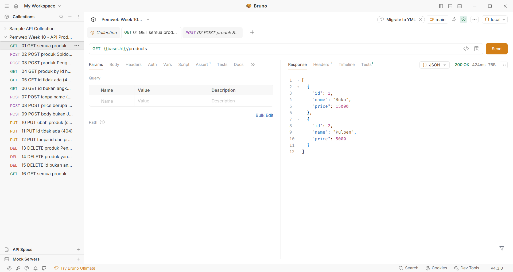

### 02. POST produk Spidol (201)

Produk disimpan dan response memuat `id` 3 yang dibuat PostgreSQL (autoincrement).

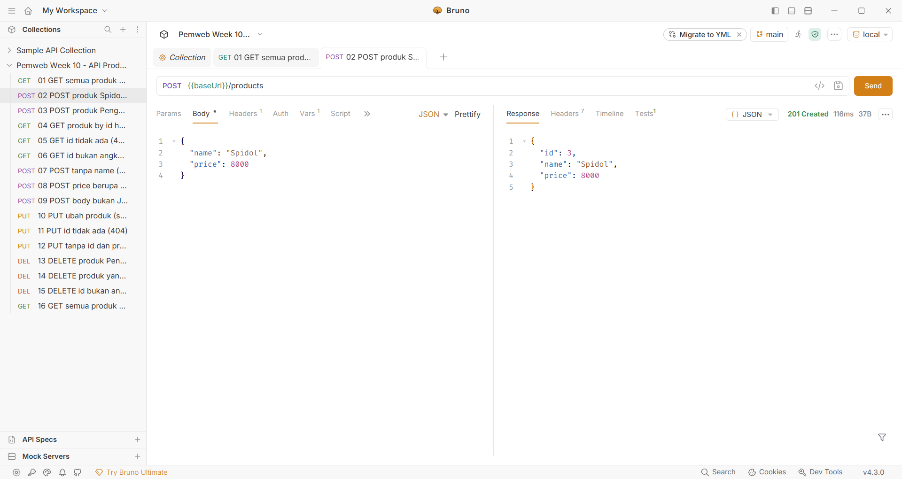

### 03. POST produk kedua (201, id berbeda)

Dua POST menghasilkan dua id berbeda (3 dan 4).

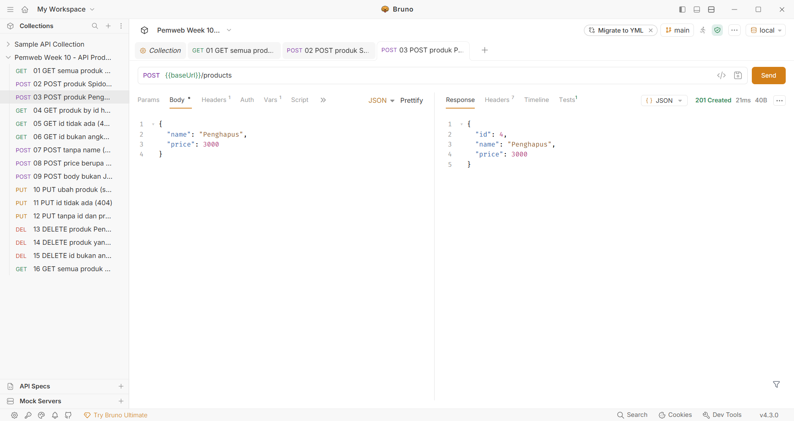

### 04. GET produk berdasarkan id hasil POST (200)

Request memakai `{{spidolId}}` dari response skenario 02 dan mengembalikan satu objek (bukan array).

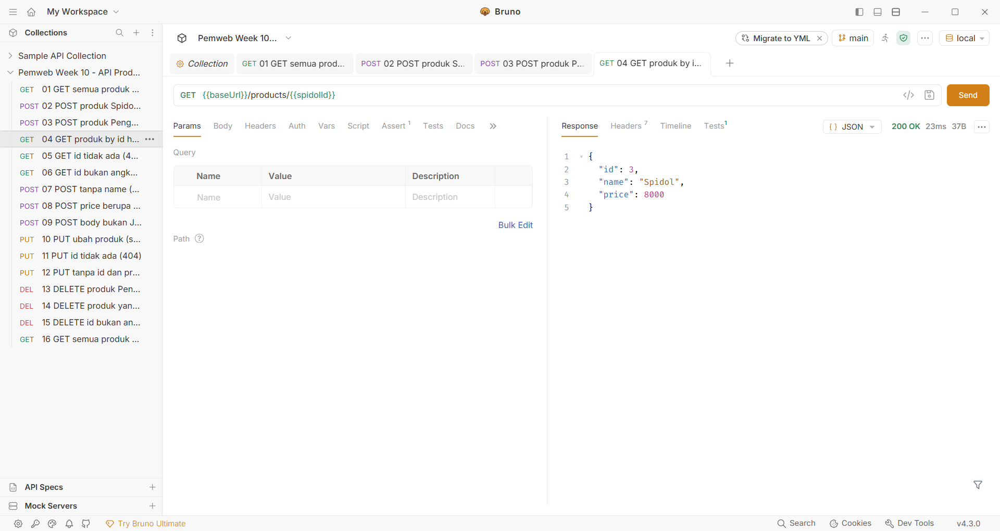

### 05. GET id tidak ada (404)

Body: `{"message": "Produk tidak ditemukan"}`.

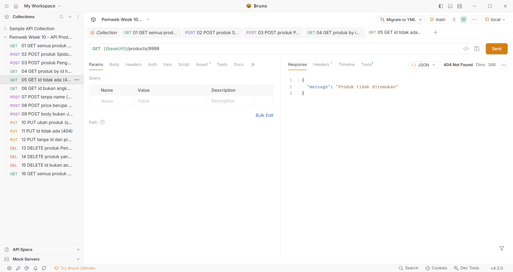

### 06. GET id bukan angka (400)

Id path harus bilangan bulat positif; body memuat `message` dan daftar `errors`.


### 07. POST tanpa name (400)

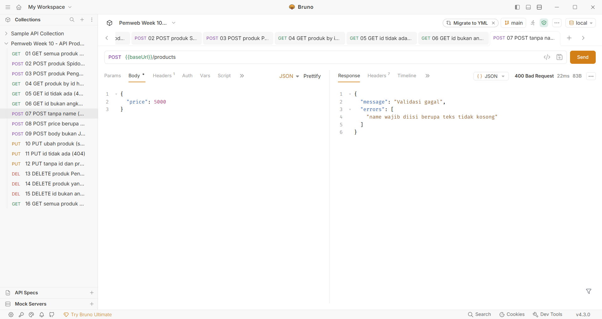

### 08. POST price berupa teks (400)

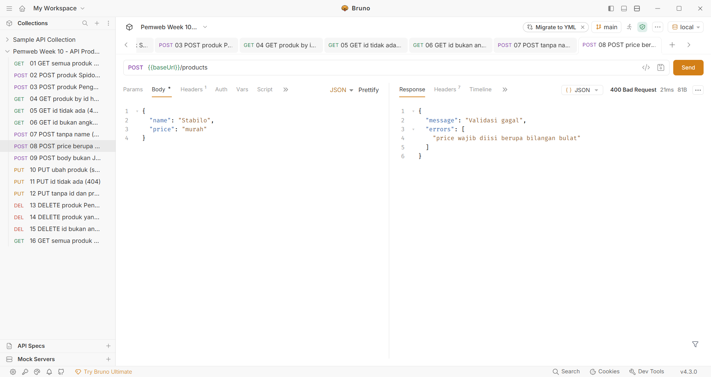

### 09. POST body bukan JSON valid (400)

Body request sengaja tidak ditutup. Server menjawab `{"message": "Body bukan JSON yang valid"}` tanpa menjatuhkan proses.

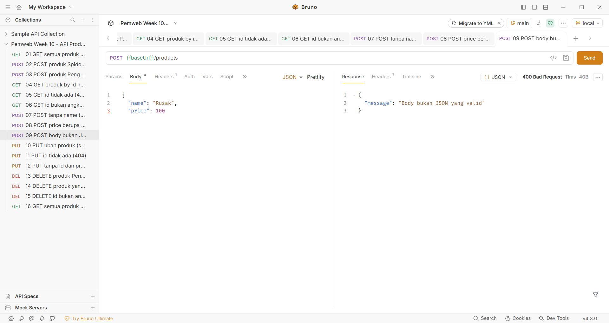

### 10. PUT ubah produk (200)

Body sama dengan POST ditambah `id`. Nama dan harga produk id 3 berubah menjadi Spidol Hitam, 9000.

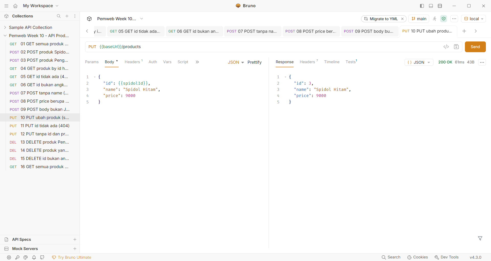

### 11. PUT id tidak ada (404)

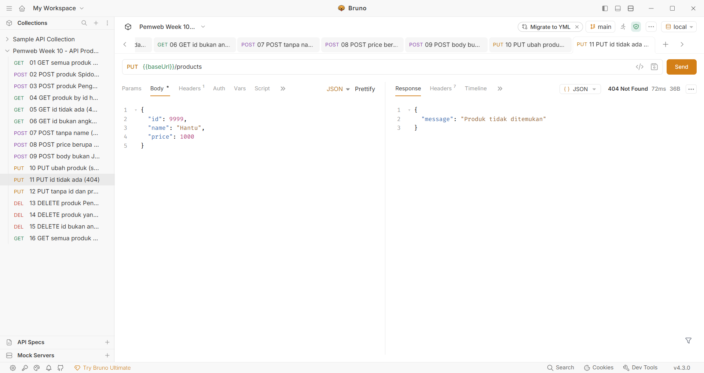

### 12. PUT tanpa id dan price negatif (400)

Dua kesalahan dilaporkan sekaligus pada `errors`.

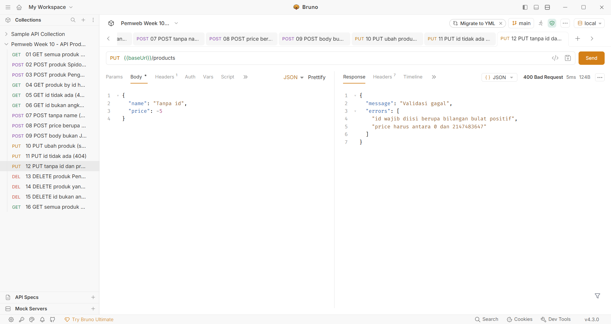

### 13. DELETE produk (200)

Produk id 4 (Penghapus) dihapus; response memuat pesan dan data produk yang dihapus.

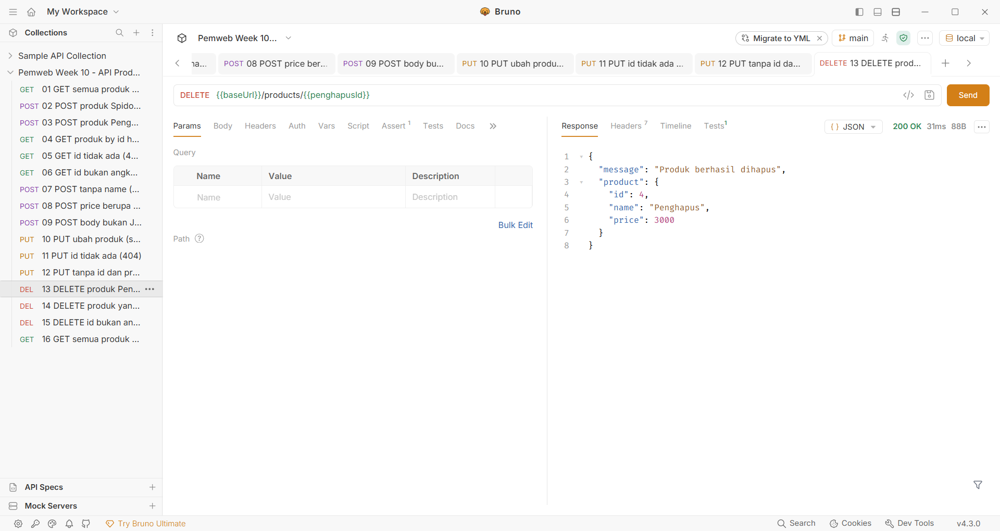

### 14. DELETE produk yang sudah terhapus (404)

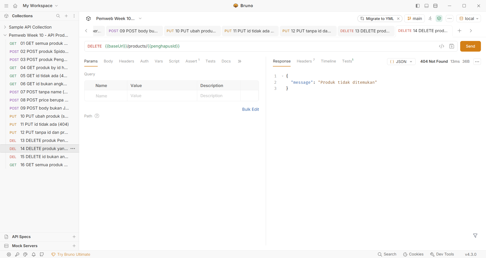

### 15. DELETE id bukan angka (400)

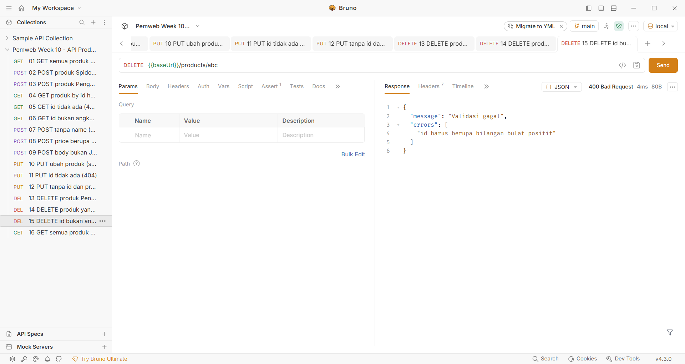

### 16. GET semua produk setelah Express restart (200)

Dijalankan setelah proses Express dimatikan dan dijalankan lagi (lihat bagian 6). Daftar produk masih memuat hasil POST dan PUT.

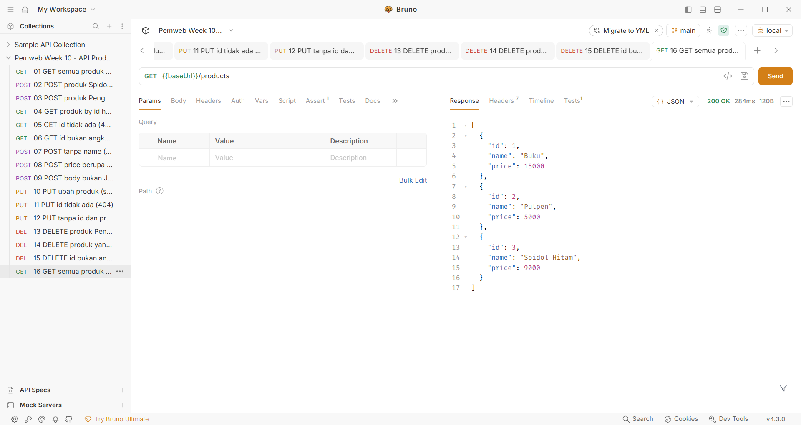

## 5. Perubahan database (sebelum dan sesudah)

Setiap gambar adalah tabel `Product` di Prisma Studio setelah halaman dimuat ulang.

| Langkah | Sebelum | Sesudah | Perubahan |
|---|---|---|---|
| POST Spidol (skenario 02) | [db-01](screenshots/db/db-01-awal.png) | [db-02](screenshots/db/db-02-setelah-post-spidol.png) | Baris id 3, Spidol, 8000 bertambah |
| POST Penghapus (skenario 03) | [db-02](screenshots/db/db-02-setelah-post-spidol.png) | [db-03](screenshots/db/db-03-setelah-post-penghapus.png) | Baris id 4, Penghapus, 3000 bertambah |
| PUT (skenario 10) | [db-03](screenshots/db/db-03-setelah-post-penghapus.png) | [db-04](screenshots/db/db-04-setelah-put.png) | id 3 menjadi Spidol Hitam, 9000 |
| DELETE (skenario 13) | [db-04](screenshots/db/db-04-setelah-put.png) | [db-05](screenshots/db/db-05-setelah-delete.png) | Baris id 4 hilang |
| Restart Express (skenario 16) | [db-05](screenshots/db/db-05-setelah-delete.png) | [db-06](screenshots/db/db-06-setelah-restart.png) | Tidak berubah, data tetap ada |

Skenario yang menghasilkan 400 atau 404 tidak mengubah database (validasi dan pencarian gagal terjadi sebelum atau tanpa penulisan).

### Awal: data seed (id 1 dan 2)

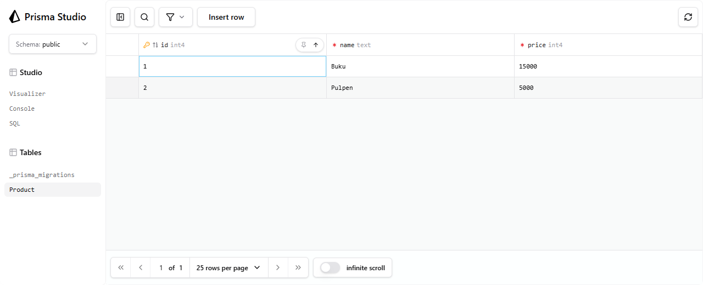

### Setelah POST Spidol (id 3 bertambah)

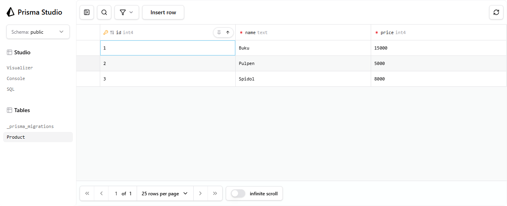

### Setelah POST Penghapus (id 4 bertambah)

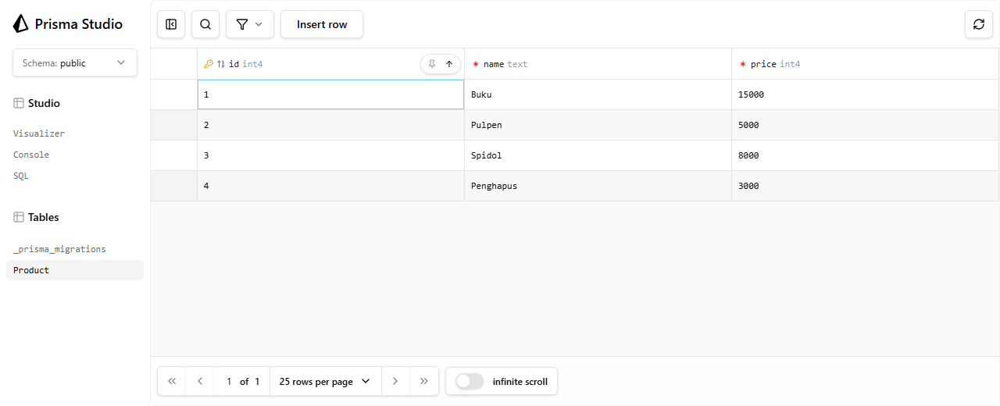

### Setelah PUT (id 3 berubah)

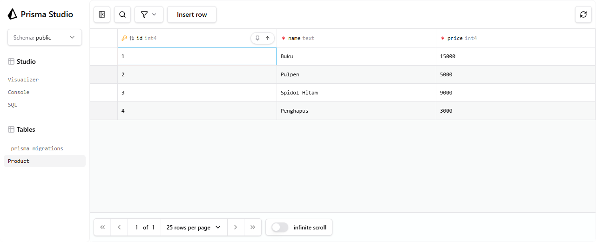

### Setelah DELETE (id 4 hilang)


### Setelah Express restart (data tetap)


## 6. Uji restart

Pertanyaan: setelah produk ditambahkan lalu Express dimulai ulang, apakah produk masih tersedia?

1. Produk ditambahkan (POST) dan diubah (PUT), lalu dicek di Prisma Studio (`db-04`, `db-05`).
2. Proses Express dimatikan. Container PostgreSQL dan volumenya tidak disentuh.
3. Proses Express dijalankan lagi (`npm run dev`). Log server pada proses baru:

```text
Server berjalan di http://localhost:3000
GET /products -> 200 (280 ms)
```

4. `GET /products` (skenario 16) mengembalikan Buku, Pulpen, dan Spidol Hitam: produk hasil POST dan PUT masih ada.
5. Prisma Studio setelah restart (`db-06`) menampilkan isi tabel yang sama.

**Jawaban: ya.** Data tersimpan di PostgreSQL, bukan di memori proses Express. Pada Minggu 9 (array) produk hasil POST hilang setelah restart.

Log proses server pertama selama skenario 01 sampai 15 (keluaran server, durasi tiap request dihilangkan):

```text
Server berjalan di http://localhost:3000
GET /products -> 200
POST /products -> 201
POST /products -> 201
GET /products/3 -> 200
GET /products/9999 -> 404
GET /products/abc -> 400
POST /products -> 400
POST /products -> 400
PUT /products -> 200
PUT /products -> 404
PUT /products -> 400
DELETE /products/4 -> 200
DELETE /products/4 -> 404
DELETE /products/abc -> 400
```

Request JSON rusak (skenario 09) tidak muncul pada log ini karena saat pengujian logger masih dipasang setelah `express.json()`. Hal ini ditemukan dari pemeriksaan log dan diperbaiki pada commit `fix(tugas-2): log requests with malformed JSON body`; respons 400 pada skenario 09 sendiri sudah benar.

## 7. Pengujian otomatis

`npm test` (`node --test` dengan `tsx`) menjalankan server sebagai proses terpisah ke PostgreSQL asli. Setiap produk yang dibuat pengujian dihapus kembali dan tabel tidak dikosongkan.

```text
tests 13
suites 6
pass 13
fail 0
```

Cakupan: GET daftar, GET by id hasil POST, 404 dan 400 untuk id (GET, PUT, DELETE), POST dua produk dengan id berbeda, pemangkasan spasi pada `name`, sembilan bentuk data POST tidak valid, body bukan JSON, PUT sukses dan gagal, DELETE sukses dan dua kali, route tidak dikenal, dan **persistensi setelah proses Express dimatikan lalu dijalankan lagi**.

## 8. Penanganan error tanpa membocorkan detail koneksi

Server sengaja dijalankan dengan `DATABASE_URL` ke database yang tidak ada (port 5999, password palsu). Hasil `GET /products`:

```text
{"message":"Terjadi kesalahan pada server"}  [HTTP 500]
```

Respons tidak memuat host, port, user, maupun password, dan password palsu itu juga tidak tercatat pada log error server.

## 9. Catatan dan keterbatasan

- Id memakai `autoincrement` PostgreSQL, sehingga id yang sudah dipakai tidak dipakai ulang setelah DELETE dan nomor bisa memiliki celah. Ini sesuai catatan materi: id tidak harus tanpa celah.
- Tidak ada autentikasi atau otorisasi; API hanya untuk latihan.
- Pengujian otomatis dan evidence manual memakai database lokal yang sama. Evidence diambil lebih dulu agar id pada gambar tetap berurutan (3 dan 4).
- Mengubah data langsung dari Prisma Studio tidak melewati validasi HTTP aplikasi. Studio hanya dipakai untuk membaca hasil.
- Aplikasi Bruno dijalankan dari salinan portabel. Koleksi request ada di folder `bruno/` dan dapat dibuka dengan *Open Collection*.

## 10. Cara mengulang pengujian

```bash
docker compose up -d
npm run db:deploy && npm run db:generate && npm run db:seed
npm run dev
# Buka folder bruno/ di Bruno, pilih environment local, jalankan request 01 sampai 16
# Matikan lalu jalankan lagi server sebelum request 16
npm run db:studio     # periksa tabel Product di http://localhost:51212
npm test
```
